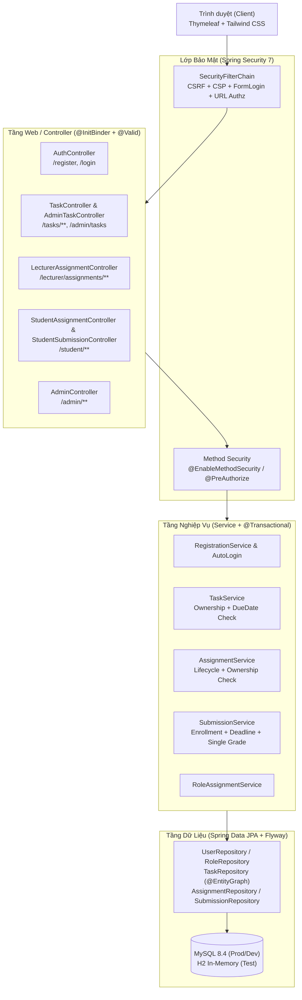
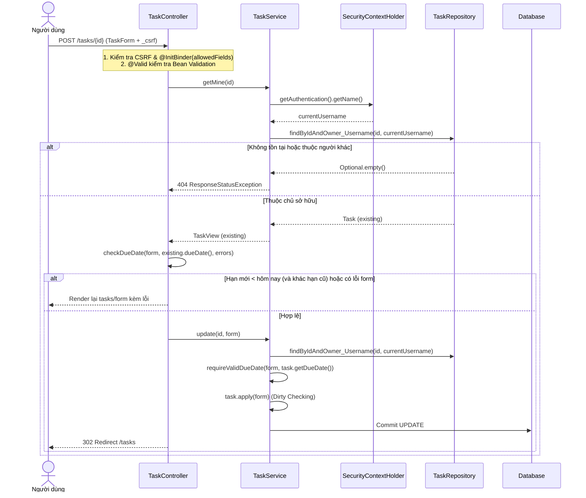
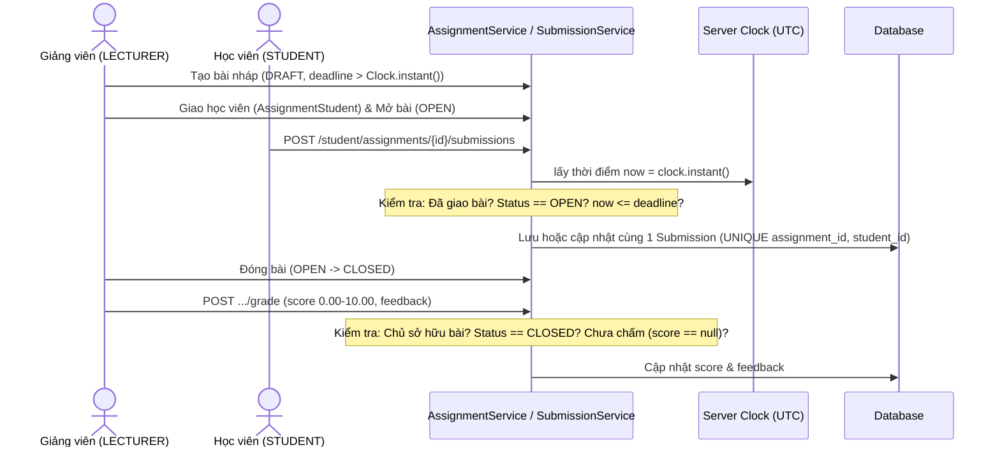
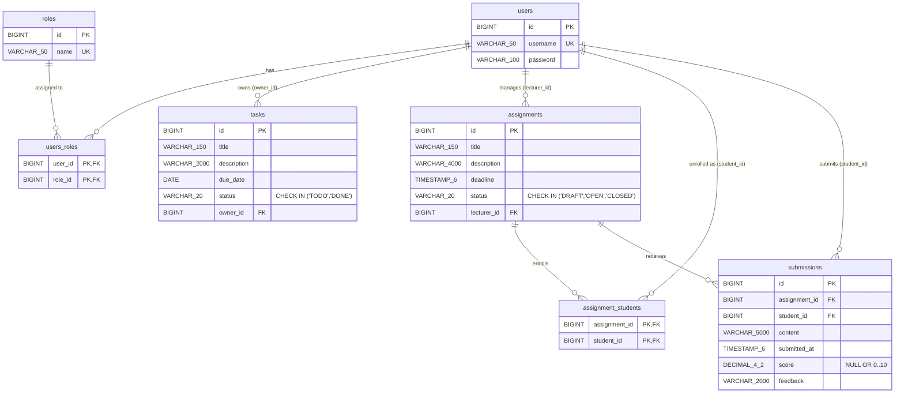

# TÀI LIỆU ĐẶC TẢ KỸ THUẬT & KIẾN TRÚC HỆ THỐNG (TECHNICAL SPECIFICATION - SA/SRS)
**Dự án**: `dynamicRole` — Quản lý Công việc Cá nhân & Cổng Giao Bài Tập Học Viên  
**Package gốc**: `org.fp.dynamicrole`  
**Stack kỹ thuật**: Java 21 · Spring Boot 4.1.1 · Spring Security 7 · Spring Data JPA / Hibernate · Flyway · Thymeleaf · Tailwind CSS (Static Bundle) · MySQL 8.4 / H2 (Test)

---

## 1. Tổng quan Kiến trúc (Architecture Overview)

Hệ thống được thiết kế theo kiến trúc phân tầng **Spring MVC Monolith chuẩn bảo mật (Defense-in-Depth)**, tách biệt rõ ràng giữa tầng giao diện (Thymeleaf + Form DTO), tầng điều phối (Controller), tầng nghiệp vụ & kiểm soát quyền sở hữu (Service + `@PreAuthorize`), và tầng truy cập dữ liệu (Spring Data JPA + Flyway Migration).

### 1.1. Sơ đồ Thành phần (C4 Component Diagram)

---

## 2. Luồng Xử lý Chính (Sequence Diagrams)

### 2.1. Luồng Tạo và Cập nhật Công việc Cá nhân (`Task`)

### 2.2. Luồng Giao bài — Nộp bài — Đóng bài — Chấm điểm

---

## 3. Thiết kế Cơ sở dữ liệu (Database Design & ERD)

### 3.1. Sơ đồ Thực thể Liên kết (ERD)

### 3.2. Lịch sử Migration (Flyway)
1. **`V1__init_schema.sql`**:
   - Tạo bảng `users`, `roles`, `users_roles`.
   - Khởi tạo dữ liệu nền `ROLE_USER`, `ROLE_ADMIN`.
2. **`V2__course.sql`**:
   - Khởi tạo thêm `ROLE_STUDENT`, `ROLE_LECTURER`.
   - Chuyển đổi các tài khoản công khai đang mang `ROLE_USER` (không phải `ADMIN`) sang `ROLE_STUDENT`.
   - Tạo bảng `assignments`, `assignment_students` (khóa chính kép `(assignment_id, student_id)`), `submissions` (ràng buộc `uk_submissions_assignment_student` và `ck_submissions_score`).
3. **`V3__create_tasks.sql`**:
   - Tạo bảng `tasks` với khóa ngoại `fk_tasks_owner` tham chiếu `users(id)`, ràng buộc `ck_tasks_status CHECK (status IN ('TODO', 'DONE'))` và chỉ mục `idx_tasks_owner_due (owner_id, due_date)`.

---

## 4. Đặc tả API / URL & Ma trận Phân quyền

| Nhóm | Method | URL Pattern | Quyền truy cập (URL / Method) | Kiểm tra sở hữu (Dữ liệu) | Mô tả xử lý |
| :--- | :--- | :--- | :--- | :--- | :--- |
| **Auth** | `GET/POST` | `/register` | `permitAll()` | Không áp dụng | Tạo tài khoản `ROLE_STUDENT`, tự động đăng nhập |
| **Auth** | `GET/POST` | `/login`, `POST /logout` | `permitAll()` / `authenticated()` | Theo Session | Đăng nhập / Hủy phiên kèm CSRF |
| **Task** | `GET` | `/tasks` | `authenticated()` | `owner.username == currentUsername()` | Phân trang 10 công việc/trang (`dueDate ASC, id DESC`) |
| **Task** | `GET/POST` | `/tasks/new`, `/tasks` | `authenticated()` + CSRF | Gán `owner` từ `SecurityContext` | Tạo công việc mới, hạn ≥ hôm nay |
| **Task** | `GET/POST` | `/tasks/{id}/edit`, `/tasks/{id}` | `authenticated()` + CSRF | `findByIdAndOwner_Username` (sai → `404`) | Sửa công việc, giữ nguyên hạn cũ hoặc chọn hạn ≥ hôm nay |
| **Task** | `POST` | `/tasks/{id}/delete` | `authenticated()` + CSRF | `findByIdAndOwner_Username` (sai → `404`) | Xóa công việc cá nhân |
| **Task** | `GET` | `/admin/tasks` | `hasRole('ADMIN')` | Toàn hệ thống (Chỉ đọc) | Giám sát toàn bộ công việc (`@EntityGraph("owner")`) |
| **Course** | `GET` | `/lecturer/assignments` | `hasRole('LECTURER')` | `lecturer.username == currentUsername()` | Danh sách bài tập của giảng viên, lọc theo `status` |
| **Course** | `GET/POST` | `/lecturer/assignments/new`, `/lecturer/assignments` | `hasRole('LECTURER')` + CSRF | Gán `lecturer` từ `SecurityContext` | Tạo bài `DRAFT`, `deadline` ở tương lai |
| **Course** | `GET/POST` | `/lecturer/assignments/{id}/edit`, `/{id}` | `hasRole('LECTURER')` + CSRF | `findByIdAndLecturer_Username` (sai → `404`) | Sửa bài khi chưa `CLOSED` |
| **Course** | `POST` | `/lecturer/assignments/{id}/open`, `/{id}/close` | `hasRole('LECTURER')` + CSRF | Chủ sở hữu bài | Chuyển trạng thái `DRAFT -> OPEN -> CLOSED` |
| **Course** | `GET/POST` | `/lecturer/assignments/{id}/students` | `hasRole('LECTURER')` + CSRF | Chủ sở hữu bài | Gán học viên (`ROLE_STUDENT`) vào bài tập |
| **Course** | `GET/POST` | `/lecturer/assignments/{id}/submissions/.../grade` | `hasRole('LECTURER')` + CSRF | Chủ sở hữu bài + `CLOSED` | Chấm điểm 1 lần (`0.00`–`10.00`, tối đa 2 số lẻ) |
| **Student** | `GET` | `/student/assignments` | `hasRole('STUDENT')` | Đã được giao trong `assignment_students` | Chỉ hiển thị bài `OPEN` (hoặc `CLOSED` khi lọc) |
| **Student** | `GET/POST` | `/student/assignments/{id}`, `/{id}/submissions` | `hasRole('STUDENT')` + CSRF | Đã được giao + `OPEN` + `now <= deadline` | Xem đề và nộp/nộp lại vào duy nhất 1 bản ghi `Submission` |
| **Student** | `GET` | `/student/submissions/{id}` | `hasRole('STUDENT')` | `student.username == currentUsername()` | Xem bài nộp, điểm và nhận xét của chính mình |
| **Admin** | `GET` | `/admin`, `/admin/assignments`, `/admin/users` | `hasRole('ADMIN')` | Toàn hệ thống | Xem thống kê, danh sách bài tập và tài khoản |
| **Admin** | `POST` | `/admin/users/{id}/role` | `hasRole('ADMIN')` + CSRF | Toàn hệ thống | Cấp/đổi vai trò người dùng có kiểm soát |

---

## 5. Thiết kế Bảo mật Chuyên sâu (Security Architecture)

### 5.1. Ba lớp bảo vệ bổ sung nhau (Defense-in-Depth)
1. **Lớp 1 — URL Security (`SecurityFilterChain`)**:
   - Chặn truy cập theo đường dẫn: `/admin/**` yêu cầu `ROLE_ADMIN`, `/lecturer/**` yêu cầu `ROLE_LECTURER`, `/student/**` yêu cầu `ROLE_STUDENT`, `/tasks/**` yêu cầu `authenticated()`.
2. **Lớp 2 — Method Security (`@EnableMethodSecurity` & `@PreAuthorize`)**:
   - Bảo vệ trực tiếp trên Spring Bean (ví dụ `TaskService.all()` yêu cầu `@PreAuthorize("hasRole('ADMIN')")`), ngăn việc gọi nhầm phương thức nhạy cảm từ controller khác.
3. **Lớp 3 — Data Ownership Query (Chặn IDOR)**:
   - Không bao giờ dùng `findById(id)` đơn thuần cho các thao tác cá nhân. Luôn truy vấn kết hợp định danh lấy từ `SecurityContextHolder` (`findByIdAndOwner_Username`, `findByIdAndLecturer_Username`, `findByAssignment_IdAndStudent_Username`).
   - Trả về `404 Not Found` khi bản ghi không thuộc người gọi để không làm lộ sự tồn tại của dữ liệu.

### 5.2. Chống Mass Assignment, CSRF, XSS và Content Security Policy (CSP)
- **Chống Mass Assignment**:
  - Không bind trực tiếp JPA Entity vào Controller.
  - Sử dụng Form DTO riêng (`TaskForm`, `AssignmentForm`, `SubmissionForm`, `GradeForm`, `RegistrationForm`) kết hợp `@InitBinder` giới hạn `setAllowedFields(...)`.
  - Entity `Task` không có `setOwner()`, constructor gọi phương thức `private assign(form)` để tránh lỗ hổng overridable method call trong constructor.
- **Chống CSRF**:
  - Bật CSRF mặc định cho toàn bộ `POST`. Mọi biểu mẫu Thymeleaf sử dụng `th:action` để tự động chèn token `_csrf`. Không dùng `GET` cho các thao tác làm thay đổi dữ liệu (xóa, mở/đóng bài, đăng xuất).
- **Chống XSS & CSP**:
  - Toàn bộ dữ liệu người dùng hiển thị qua `th:text` (tự động HTML-escape), tuyệt đối không dùng `th:utext`.
  - Header `Content-Security-Policy`: `default-src 'self'; form-action 'self'; frame-ancestors 'none'; base-uri 'self'`.
  - Bộ giao diện **Tailwind CSS** được biên dịch tĩnh tại `/css/app.css` phục vụ trực tiếp từ `'self'`, không phụ thuộc CDN bên ngoài và không dùng inline script/style.

### 5.3. Xử lý Thời gian & Hạn nộp
- Hạn nộp bài tập (`Assignment.deadline`) và thời điểm nộp (`Submission.submittedAt`) sử dụng `java.time.Instant` theo `Clock` của server (lưu UTC trong DB, hiển thị múi giờ `Asia/Ho_Chi_Minh`).
- Hạn công việc cá nhân (`Task.dueDate`) sử dụng `java.time.LocalDate` kết hợp phương thức `TaskForm.isDueDateAcceptable(LocalDate current, LocalDate today)` ở cả Controller (hiển thị lỗi trên form) và Service (lớp bảo vệ cuối).

---

## 6. Ma trận Kiểm thử Tự động (Automated Test Coverage)

Toàn bộ **32 bài kiểm thử tự động** chạy trên H2 In-Memory (`@ActiveProfiles("test")`, `@Transactional` tự động rollback sau mỗi test):

1. **`RegistrationLoginTest` (5 tests)**:
   - Đăng ký thành công, băm `{bcrypt}`, tự động đăng nhập và bỏ qua tham số `roles=ROLE_ADMIN` gửi kèm (Kịch bản **T10**).
   - Từ chối trùng `username`, lệch `passwordConfirm`, thiếu CSRF, và kiểm tra luồng `login` → `logout`.
2. **`TaskSecurityTest` (14 tests — chuẩn bản cập nhật `3.pdf`)**:
   - `anonymousMustLogin`: Chưa đăng nhập mở `/tasks` chuyển hướng về `/login`.
   - `bobCannotEditAliceTask`, `bobCannotUpdateAliceTask`, `bobCannotDeleteAliceTask`: Chặn người dùng B xem/sửa/xóa việc của người A (`404`).
   - `adminCannotUpdateAliceTask`: Chứng minh `ADMIN` cũng không sửa được công việc cá nhân của người khác (`404`).
   - `deleteWithoutCsrfIsRejected`: Chặn `POST` xóa thiếu CSRF (`403`).
   - `aliceCanUpdateOwnTask`, `blankTitleIsNotSaved`: Luồng cập nhật hợp lệ và kiểm tra Bean Validation.
   - `cannotCreateTaskWithPastDueDate`, `overdueTaskCanBeMarkedDoneKeepingDueDate`, `changingDueDateToThePastIsRejected`: Chứng minh đầy đủ quy tắc hạn ngày mới của `3.pdf`.
   - `userCannotOpenAdmin` (`403`), `adminCanOpenAdmin` (`200`), `userCannotCallAdminServiceMethod` (`AccessDeniedException` ở lớp `@PreAuthorize`).
3. **`PortalRequirementTest` (12 tests)**:
   - Phủ toàn bộ kịch bản **T01 – T09** của Cổng giao bài tập: chặn đọc/sửa chéo `Submission` (T01), chặn giảng viên sửa/chấm bài người khác (T02), chặn học viên chưa được giao bài nộp (T03), kiểm tra biên thời gian đúng hạn/quá hạn/đóng bài (T04), CSRF (T05), nộp lại giữ 1 bản ghi & bỏ qua `studentId` từ client (T06), kiểm tra biên điểm số `DECIMAL(4,2)` (T07), chặn `STUDENT`/`ADMIN` chấm điểm (T08), chống XSS tiêu đề & cô lập phạm vi tìm kiếm (T09), phân trang 10 bản ghi/trang và luồng hoàn chỉnh từ tạo bài → giao → mở → nộp → đóng → chấm 1 lần.
4. **`DynamicRoleApplicationTests` (1 test)**:
   - Kiểm tra khởi tạo Spring ApplicationContext và Flyway schema validation.

---

## 7. Danh mục Yêu cầu Phi chức năng (NFR Checklist)

| Hạng mục | Giải pháp áp dụng trong dự án | Trạng thái |
| :--- | :--- | :-: |
| **Security** | Spring Security 7, BCrypt, CSRF, CSP `'self'`, `@PreAuthorize`, chống IDOR & Mass Assignment | Đạt |
| **Performance** | `@EntityGraph` chống lỗi N+1 query, tắt `open-in-view`, phân trang cố định 10 bản ghi/trang | Đạt |
| **Data Integrity** | Flyway quản lý versioned migration (`V1`, `V2`, `V3`), `ddl-auto=validate`, FK + Unique + Check constraints | Đạt |
| **Maintainability** | Tách biệt rõ theo module (`user`, `security`, `task`, `course`, `submission`, `web`), 32 automated tests | Đạt |
| **Usability / UI** | Giao diện tiếng Việt chuẩn UTF-8, thiết kế hiện đại bằng Tailwind CSS tĩnh, thông báo lỗi trực quan trên từng trường | Đạt |

